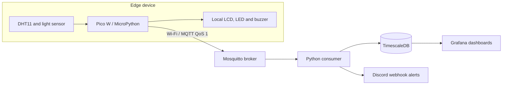

# System architecture

This diagram documents the pipeline described in the root README.

## Responsibilities

- The Pico W reads environmental sensors and evaluates local alert thresholds.
- MQTT transports telemetry and alert flags to the broker.
- The Python consumer ingests messages into TimescaleDB and can dispatch Discord notifications.
- Grafana visualizes stored time-series readings.

## Configuration and safety

- Keep Wi-Fi credentials, database passwords and webhook URLs in local environment/configuration files that are excluded from Git.
- Replace example credentials before deployment.
- Configure the MQTT broker address for the actual network; do not rely on a developer's private LAN address.
- Validate sensor readings and handle network outages without blocking local safety alerts.
